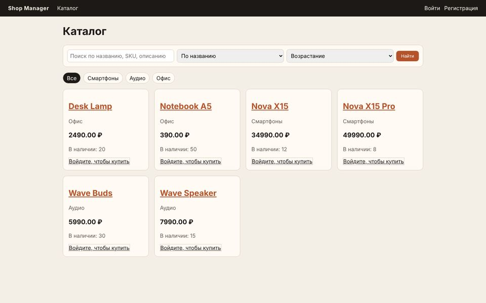
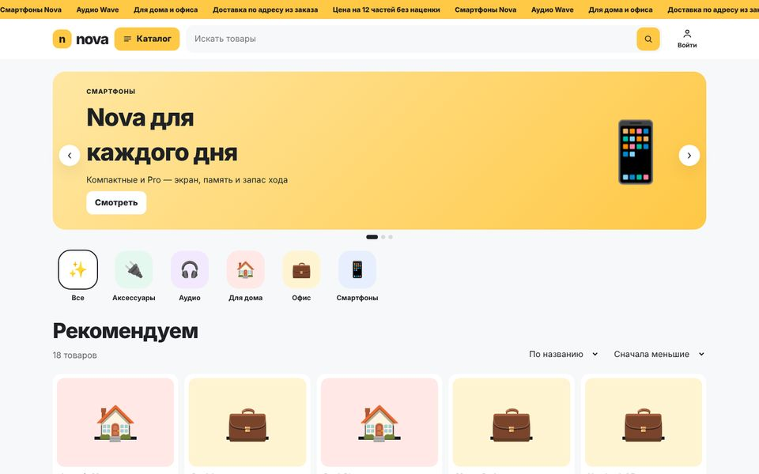
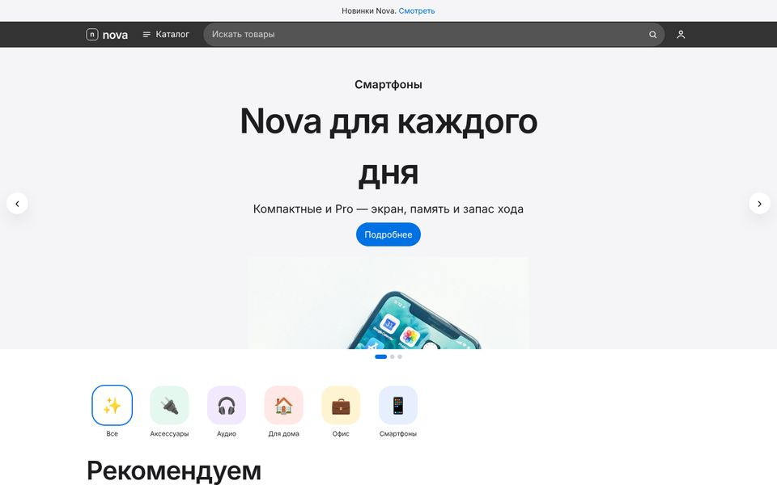
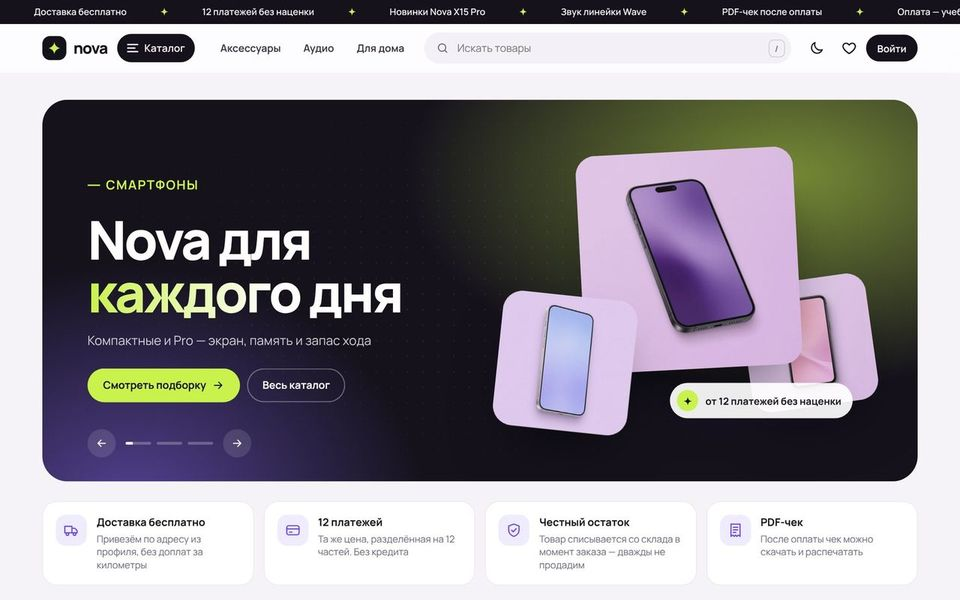
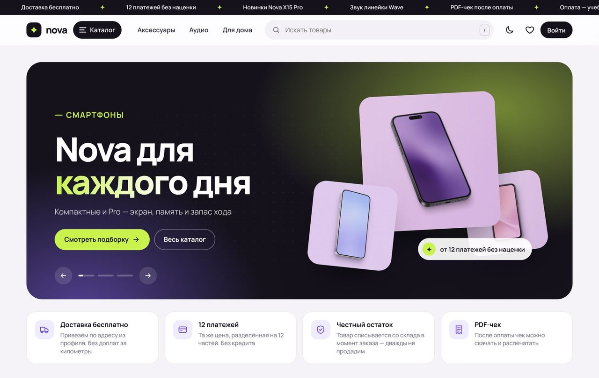

# 📓 Дневник разработки Shop Manager

Как учебный магазин вырос из простого каталога в витрину **nova**. Записи собраны по истории коммитов: даты, что сделано, какие решения приняты и какие баги пойманы.

[← Вернуться к README](README.md)

<table>
  <tr>
    <td align="center" width="20%"> <b>07.10</b> · первый каталог</td>
    <td align="center" width="20%"> <b>29.10</b> · маркетплейс</td>
    <td align="center" width="20%"> <b>29.10</b> · светлая</td>
    <td align="center" width="20%"> <b>05.11</b> · тёмная</td>
    <td align="center" width="20%"> <b>18.11</b> · nova</td>
  </tr>
</table>

Все пять кадров сняты с настоящих сборок соответствующих коммитов в демо-режиме, а не нарисованы заново.

## Коротко в цифрах

| | Старт (07.10) | Сейчас (18.11) |
|---|---|---|
| Роли | покупатель, администратор | покупатель, менеджер, кладовщик, администратор |
| Автотесты | 14 | 27 |
| Миграции Flyway | 1 | 2 |
| Выгрузки отчёта | — | CSV и ODS |
| Оплата | смена статуса сотрудником | учебная оплата с проверкой карты и PDF-чеком |
| Темы оформления | 1 | светлая и тёмная |

---

## 07.10.2026 — Этап 1. Каркас магазина

**Коммит** `75d9230` · Добавить учебный магазин со Spring Security и схемой PostgreSQL

- Поднят модульный монолит на **Spring Boot**: пакеты `catalog`, `cart`, `customer`, `order`, `report` и адаптеры `web`, `admin`, `api`.
- Схема базы описана миграцией **Flyway** `V1__init.sql`: 8 таблиц, внешние ключи, `CHECK` на цену и остаток, уникальные `sku`, `email`, `slug`.
- **Spring Security**: форма входа для сайта и HTTP Basic для API, пароли — BCrypt.
- Заказ как конечный автомат: `NEW → PAID → PROCESSING → SHIPPED → DELIVERED`, отмена до отгрузки.
- Списание остатка и создание заказа — в одной транзакции, в строке заказа хранится снимок цены и названия.
- Коллекция Postman и **14 автотестов** (MockMvc + H2).

**Решение:** один сервисный слой для сайта и API — правила не дублируются, и Postman проверяет то же, что видит покупатель.

 

## 13.10.2026 — Этап 2. Роли сотрудников и CSV

**Коммит** `60bf151` · Добавить роли менеджера и кладовщика, выгрузку отчёта в CSV и полный отчёт

- Появились роли **MANAGER** (заказы, клиенты, отчёт) и **WAREHOUSE** (товары и категории).
- Администратор назначает роли в списке клиентов; нельзя менять собственную роль и снимать последнего администратора.
- Выгрузка отчёта в **CSV** с BOM, чтобы кириллица открывалась в табличном редакторе.
- Расширенные демо-данные, тесты `t13`–`t14` — всего **16** тестов.
- Скрипт `Запустить.bat` для Windows.

## 29.10.2026 — Этап 3. Витрина в стиле маркетплейса

**Коммиты** `aa47fae`, `7af3467` · Переделать витрину в стиле маркетплейса · Добавить фотографии товаров

- Жёлтая шапка, слайдер, ряд категорий, карточки с анимацией.
- Страница **профиля**: имя, телефон, email, адрес и пароль; адрес добавила миграция `V2__customer_address.sql`.
- Цена на карточке делится на 12 равных частей — «рассрочка» без кредита.
- Фотографии всех 18 товаров лежат в репозитории, чтобы витрина работала без интернета.

 

## 29.10.2026 — Этап 4. Светлая витрина и учебная оплата

**Коммиты** `d977de3`, `a49014c` · Перевести витрину на светлый формат · Добавить учебную оплату с PDF-чеком

- Витрина в духе apple.com: полупрозрачный хедер, крупный слайд, синие кнопки.
- В тот же день — тёмно-фиолетовая тема и **учебная оплата**: форма карты, перевод заказа в `PAID`, **PDF-чек** с печатью магазина (OpenPDF и шрифт DejaVu Sans для кириллицы).
- Демо-заказы в отчёте: 11 клиентов, выручка 130 260 ₽.

 

## 05.11.2026 — Этап 5. Сравнение выручки и ODS

**Коммиты** `fc141c3`, `e89d873` · Обновить витрину и отчёт магазина · Убрать учебные отчёты из репозитория

- Отчёт сравнивает выручку **по дням, моделям и категориям**, столбцы сортируются кликом.
- Выгрузка в **ODS** для LibreOffice — собственный писатель `OdsReport` без внешних библиотек.
- Добавление в корзину без перезагрузки страницы, фото товаров на фоне карточки.
- Появился README, тестов стало **20**.
- Учебные отчёты убраны из Git и хранятся только локально.

 

## 18.11.2026 — Этап 6. Витрина nova

**Коммит** `570a897` · Переделать витрину nova: новый дизайн, тёмная тема и живое поведение

**Дизайн**
- Дизайн-система на переменных CSS: светлая и тёмная темы, шрифт Manrope (хранится локально), фиолетовый и лаймовый акценты.
- Свои SVG-иконки и анимированные иллюстрации для пустой корзины, пустого поиска и страницы 404.
- Слайдер с параллаксом и полосой прогресса, bento-сетка категорий, липкая панель фильтров, вид «плитка / список».

**Поведение**
- Живой поиск с подсказками и навигацией стрелками, клавиша `/` переводит фокус в поиск.
- Избранное и «Вы недавно смотрели» в браузере — работают без входа.
- Быстрый просмотр в модальном окне, товар «улетает» в корзину, уведомления.
- Корзина меняет количество без перезагрузки; на оплате живая карта с проверкой номера по алгоритму Луна.
- Все формы по-прежнему работают без JavaScript; анимации отключаются через `prefers-reduced-motion`.

**Найденные и исправленные баги**

| Баг | Причина | Исправление |
|---|---|---|
| Страница входа обрывалась ошибкой `Cannot create a session after the response has been committed` | Spring Security создаёт CSRF-токен лениво; когда HTML превысил буфер Tomcat, ответ начал уходить раньше, чем понадобилась сессия | Токен запрашивается до отрисовки страницы; добавлен `PageRenderTest` на настоящем Tomcat, который без исправления падает |
| Первая ячейка сетки каталога пустая, нижние карточки полупрозрачные | Старая вёрстка и анимация появления срабатывали не для всех карточек | Каталог свёрстан заново, появление — через Intersection Observer |
| `gradlew` не запускался в Linux и macOS | Файл попал в Git без права на выполнение | Право восстановлено в индексе Git |
| Ошибки показывались белой страницей Spring Boot | Не было шаблона `error.html` | Страница ошибок 403/404/500 в стиле магазина |

Тестов стало **27**. Отчёт по проекту переоформлен по ГОСТ 7.32-2017, UML-диаграммы перерисованы.

## 18.11.2026 — Полировка после проверки

| Коммит | Что исправлено |
|---|---|
| `615d108` | На телефоне у гостя обрезалась кнопка «Войти» — поле поиска не сжималось. Теперь поиск сжимается, а вход живёт в нижнем меню; подсказка зума скрыта на сенсорных экранах |
| `820512c` | Выбранная тема сбрасывалась при переходе: `app.js` писал в `localStorage` значение `"dark"` с кавычками, а скрипт в `<head>` ждал `dark`. Теперь значение пишется строкой, старое тоже понимается |
| `1333ac2` | `Запустить.bat` ищет JDK 17 по маске, а не по жёсткой версии |

## 18.11.2026 — Оформление репозитория

- Новый README: баннер под светлую и тёмную тему GitHub, галерея скриншотов, UML-диаграммы, раскрывающиеся секции.
- Этот дневник и лента эволюции дизайна, снятая со сборок старых коммитов.

---

## Инструменты

Java 17 · Spring Boot 3.5 · PostgreSQL 16 · Gradle · Git · Postman · Playwright (скриншоты) · ИИ-ассистенты Cursor и Claude Code — их участие видно в истории коммитов (поле `Co-authored-by`).

[← Вернуться к README](README.md)
