<picture>
  <source media="(prefers-color-scheme: dark)" srcset=".github/assets/banner-dark.png">
  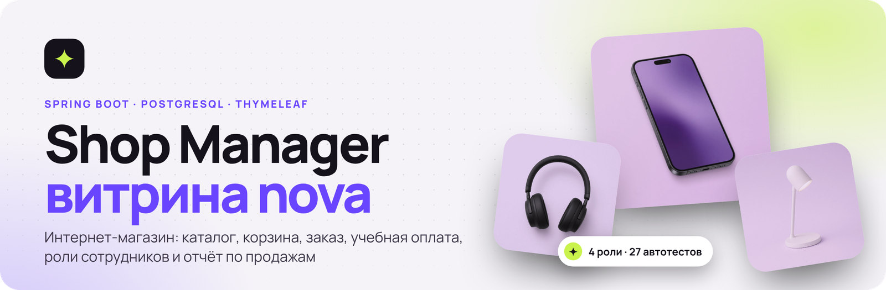
</picture>

<p align="center">
  
  
  
  
  
  
  
</p>

<p align="center">
  <a href="#-скриншоты">Скриншоты</a> ·
  <a href="#-что-умеет-система">Возможности</a> ·
  <a href="#-быстрый-старт">Запуск</a> ·
  <a href="#-архитектура">Архитектура</a> ·
  <a href="#-rest-api">API</a> ·
  <a href="#-тестирование">Тесты</a> ·
  <a href="DEVLOG.md">Дневник разработки</a>
</p>

## 👋 Привет! Я Азар Абдулаев

Студент **Российско-Таджикского (Славянского) университета**. Это мой проект — система управления интернет-магазином: от предметной области и ролей до работающей витрины, REST API и автотестов.

Покупатель идёт по цепочке «каталог — корзина — заказ — оплата». Сотрудник ведёт товары, клиентов и статусы. Правила одни и те же и на сайте, и в JSON: остаток нельзя списать дважды, а чужой заказ покупатель не откроет.

<table>
  <tr>
    <td align="center"><b>8</b><br><sub>таблиц в БД</sub></td>
    <td align="center"><b>4</b><br><sub>роли</sub></td>
    <td align="center"><b>18</b><br><sub>товаров</sub></td>
    <td align="center"><b>5</b><br><sub>категорий</sub></td>
    <td align="center"><b>27</b><br><sub>автотестов</sub></td>
    <td align="center"><b>2</b><br><sub>темы оформления</sub></td>
  </tr>
</table>

## 📸 Скриншоты

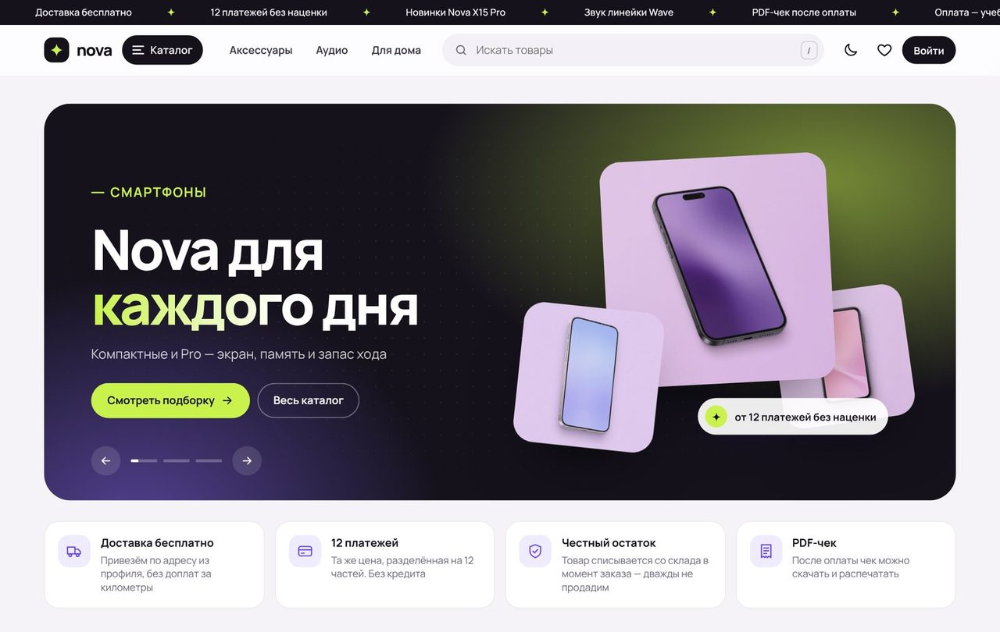

<table>
  <tr>
    <td width="50%">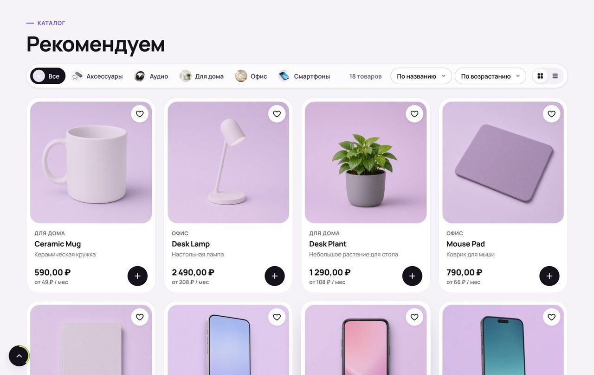<br><sub><b>Каталог</b> — чипы категорий, сортировка, плитка или список</sub></td>
    <td width="50%">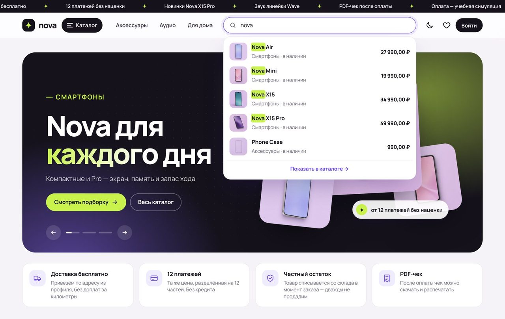<br><sub><b>Живой поиск</b> — подсказки с фото и ценой, навигация стрелками</sub></td>
  </tr>
  <tr>
    <td>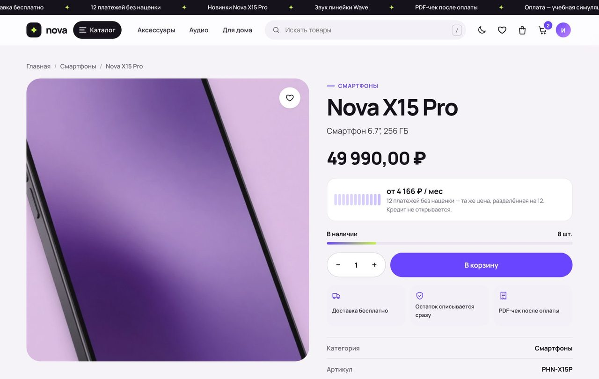<br><sub><b>Товар</b> — зум фото, шкала остатка, 12 платежей без наценки</sub></td>
    <td>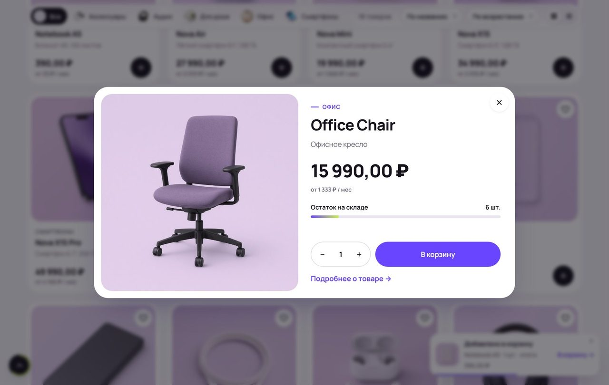<br><sub><b>Быстрый просмотр</b> — покупка прямо из каталога</sub></td>
  </tr>
  <tr>
    <td>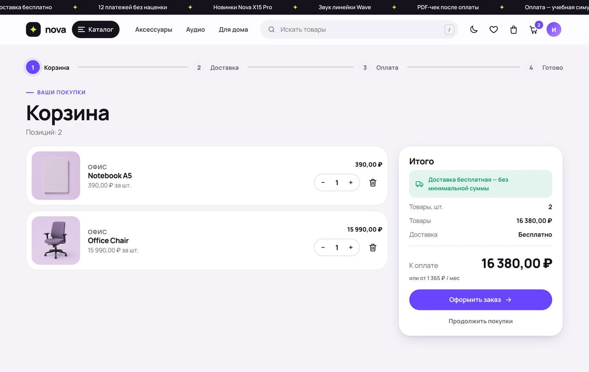<br><sub><b>Корзина</b> — количество меняется без перезагрузки</sub></td>
    <td>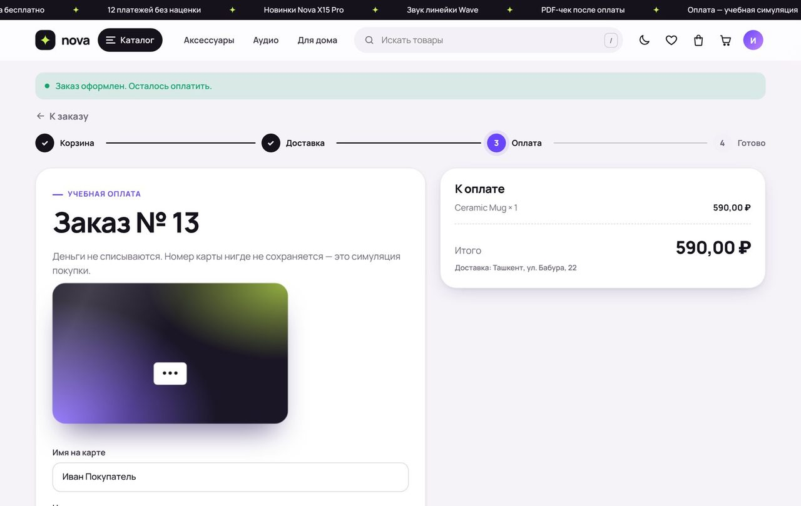<br><sub><b>Учебная оплата</b> — живая карта, проверка Луна, переворот на CVC</sub></td>
  </tr>
  <tr>
    <td>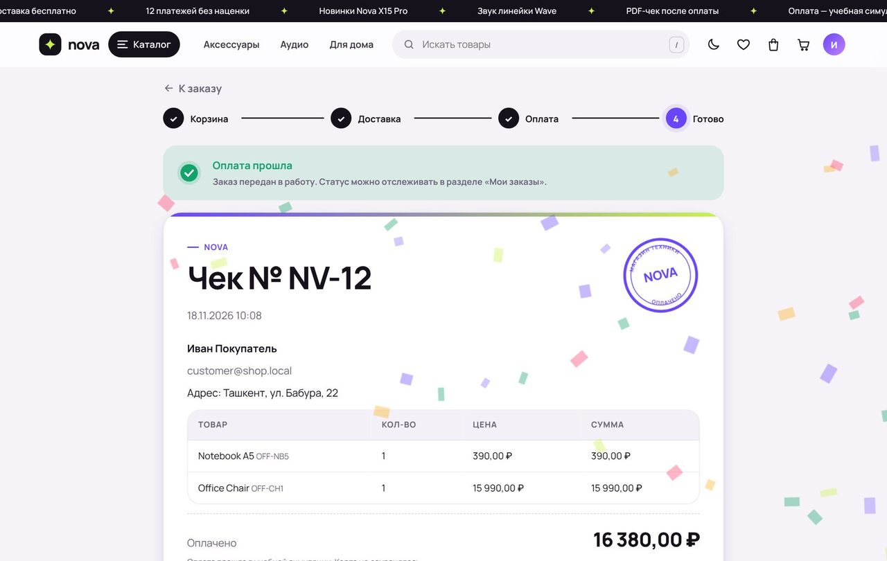<br><sub><b>Чек</b> — печать магазина, PDF и печать</sub></td>
    <td>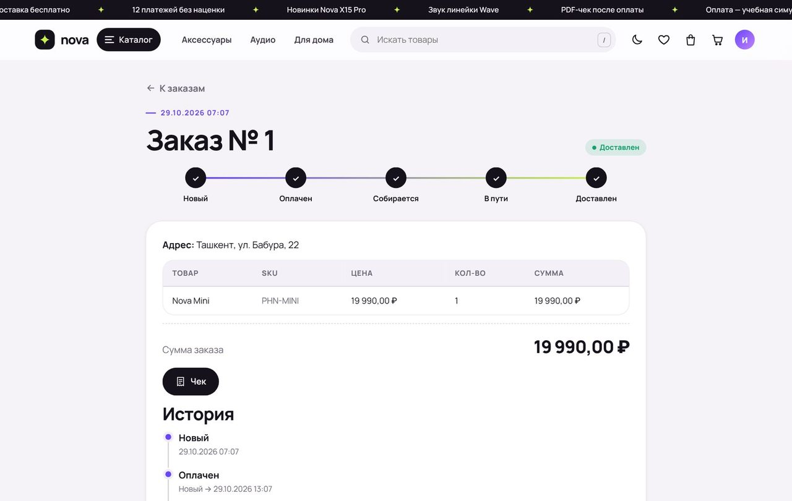<br><sub><b>Заказ</b> — трекер статуса и история переходов</sub></td>
  </tr>
  <tr>
    <td>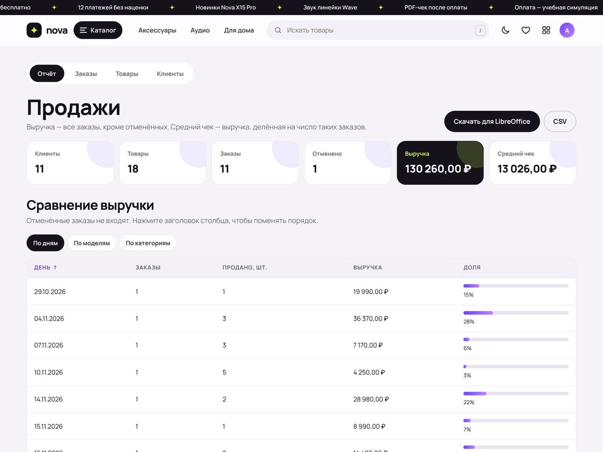<br><sub><b>Отчёт</b> — KPI, сравнение выручки, CSV и ODS</sub></td>
    <td>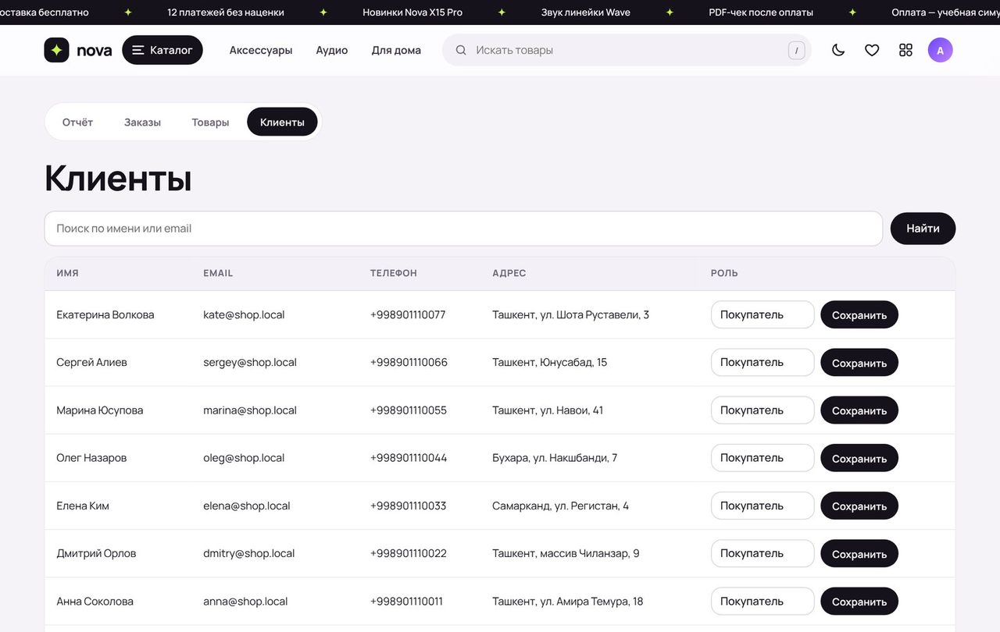<br><sub><b>Роли</b> — администратор назначает сотрудников</sub></td>
  </tr>
</table>

<details>
<summary><b>🌙 Тёмная тема, 📱 телефон и ещё экраны</b></summary>
<br>

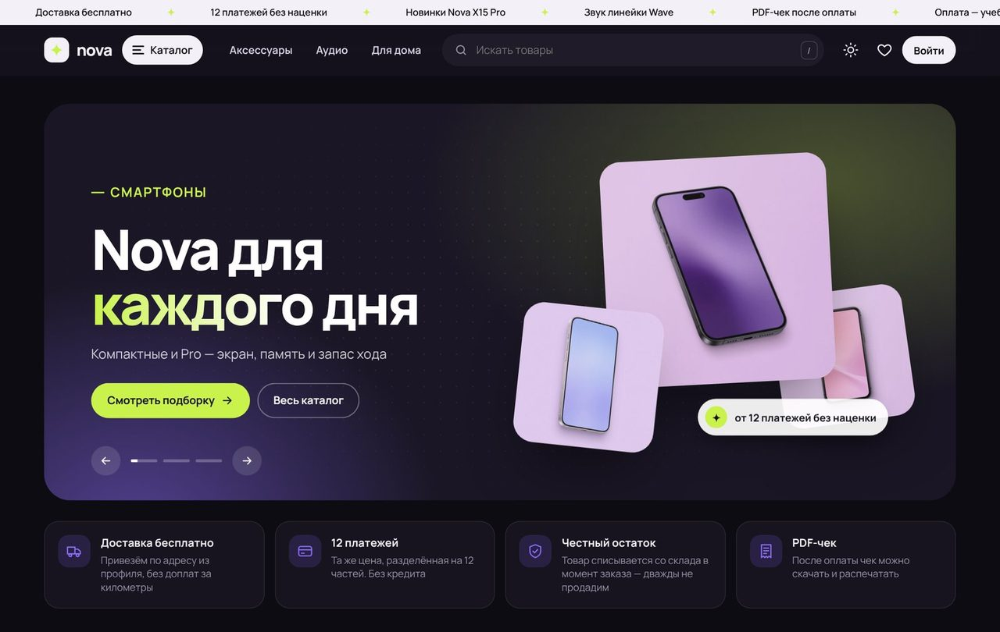


<table>
  <tr>
    <td width="50%">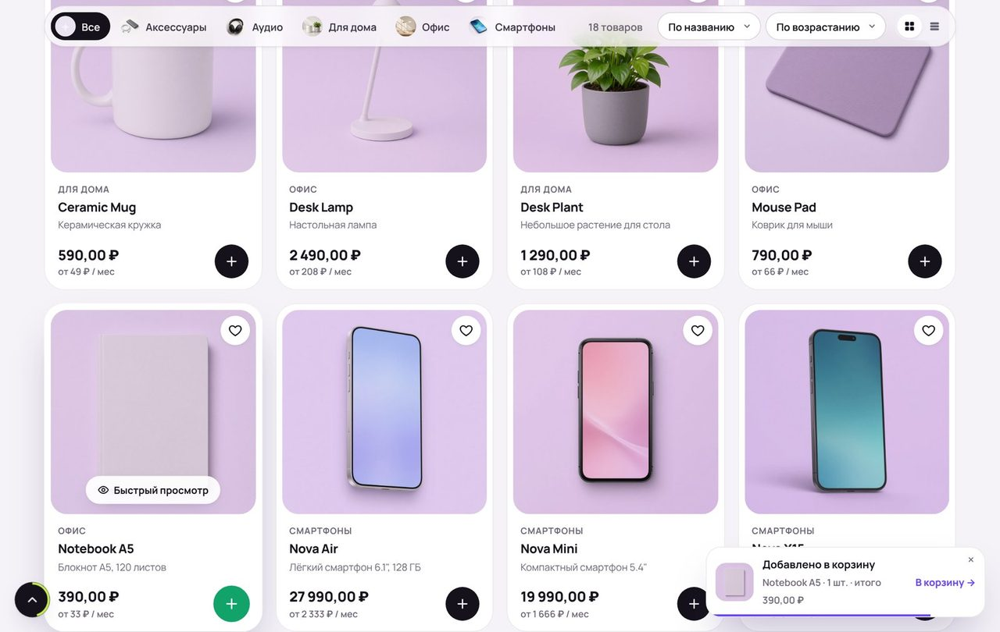<br><sub>Товар «улетает» в корзину, справа — уведомление</sub></td>
    <td width="50%">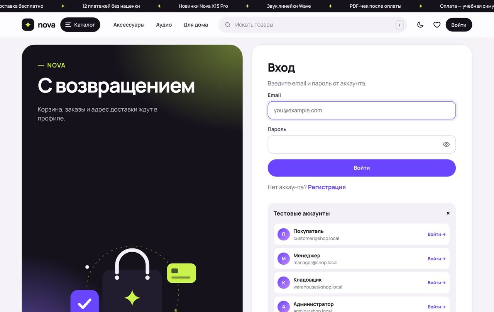<br><sub>Вход одной кнопкой для тестовых учётных записей</sub></td>
  </tr>
  <tr>
    <td colspan="2">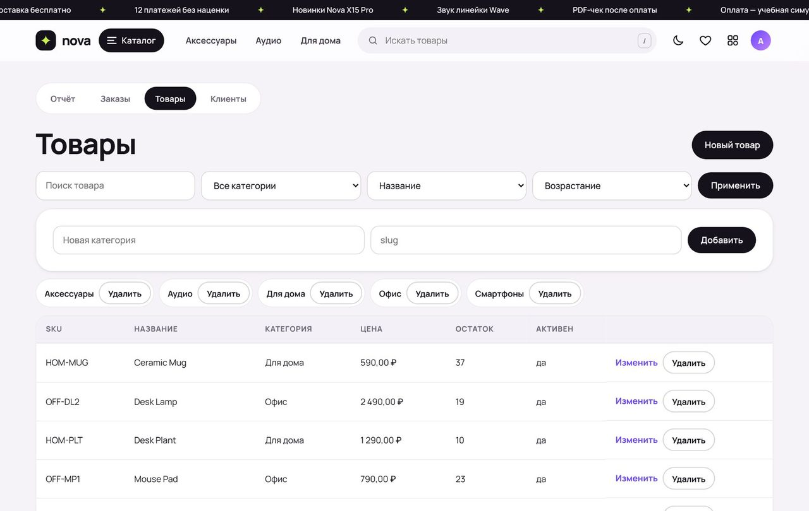<br><sub>Товары и категории в разделе кладовщика</sub></td>
  </tr>
</table>
</details>

## 🧭 Что умеет система

| Для кого | Что может |
|---|---|
| 👤 **Гость** | смотрит каталог, ищет и фильтрует товары, ведёт избранное, регистрируется |
| 🛒 **Покупатель** | кладёт товар в корзину без перезагрузки, оформляет заказ, оплачивает учебную форму, скачивает PDF-чек, следит за статусом |
| 📦 **Кладовщик** | создаёт и правит товары и категории |
| 📋 **Менеджер** | ведёт заказы по допустимым статусам, смотрит клиентов и отчёт |
| 🛠 **Администратор** | всё перечисленное, плюс роли сотрудников и выгрузка отчёта в CSV и ODS |

**Ключевые возможности**

- **Каталог** — поиск без учёта регистра по названию, артикулу и описанию, фильтр по категории, сортировка по имени, цене и остатку
- **Живой поиск** — подсказки с фото и ценой прямо под строкой поиска, навигация стрелками, `/` — фокус на поиск
- **Корзина** — повтор товара увеличивает количество, остаток проверяется ещё до оформления, количество меняется без перезагрузки
- **Заказ** — снимок названия и цены, списание остатка в одной транзакции, история статусов, конечный автомат переходов
- **Оплата** — учебная страница с живой картой и PDF-чек, без обращения в банк и без сохранения номера карты
- **Отчёт** — выручка без отмен, средний чек, сравнение по дням, моделям и категориям, сортировка столбцов, выгрузка CSV и ODS
- **Избранное и история** — сердечко на карточке и «Вы недавно смотрели» работают даже без входа
- **Тёмная тема** — переключатель в шапке, по умолчанию берётся тема системы, выбор запоминается
- **Доступность** — работа с клавиатуры, `prefers-reduced-motion`, формы работают и без JavaScript

## 🛠 Стек

| Слой | Технологии |
|---|---|
| Backend | Java 17 · Spring Boot 3.5 (Web, Security, Data JPA, Validation) · Hibernate 6 |
| База данных | PostgreSQL 16 · Flyway (2 миграции) · H2 для демо и тестов |
| Frontend | Thymeleaf · собственные CSS и JS без фреймворка · View Transitions API · шрифт Manrope (локально) |
| Документы | OpenPDF — чек; ODS — книга отчёта для LibreOffice |
| Тестирование | JUnit 5 · MockMvc · настоящий Tomcat на случайном порту |
| Инструменты | Gradle · Git · Docker Compose для базы · Postman |

## 🚀 Быстрый старт

> **Нужно:** JDK 17. Для основного режима — ещё PostgreSQL 16.

**Демо за минуту — без PostgreSQL** (встроенная база H2, данные создаются при каждом запуске):

```bash
./gradlew bootRun --args="--spring.profiles.active=demo"
```

**Основной режим с PostgreSQL.** Базу можно поднять из `docker-compose.yml` (имя базы, пользователь и пароль — учебные, только для локального запуска):

```bash
docker compose up -d
```

```bash
./gradlew bootRun
```

Либо своя база `shop_manager` — параметры подключения в `src/main/resources/application.yml`; для своей машины скопируйте их в `application-local.yml` (в Git не попадает). На Windows можно запустить `Запустить.bat`: он сам найдёт JDK 17 и запустит службу PostgreSQL.

Сайт: **http://localhost:8080**. Логины и пароли показаны на странице входа — это демонстрационные записи `@shop.local`, не настоящие люди.

| Роль | Email | Пароль |
|---|---|---|
| Покупатель | `customer@shop.local` | `customer123` |
| Менеджер | `manager@shop.local` | `manager123` |
| Кладовщик | `warehouse@shop.local` | `warehouse123` |
| Администратор | `admin@shop.local` | `admin123` |

## 🏗 Архитектура

Модульный монолит: один процесс Spring Boot, сайт и REST API работают поверх одних и тех же сервисов.

<p align="center">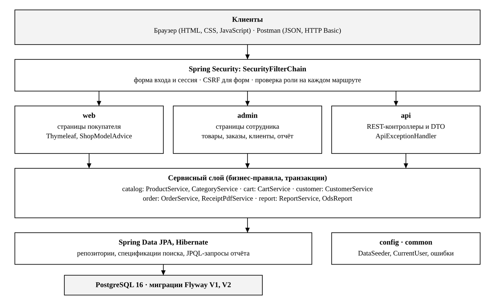</p>

```
src/main/java/com/shopmanager
├── api/          REST и DTO
├── web/          страницы покупателя
├── admin/        страницы сотрудника
├── catalog/      товары, категории, поиск
├── cart/         корзина и проверка остатка
├── customer/     регистрация, роли, профиль
├── order/        заказ, статусы, чек
├── report/       сводка, сравнение выручки, CSV и ODS
├── config/       безопасность и начальные данные
└── common/       ошибки API
```

<details>
<summary><b>📐 UML-диаграммы и схема базы данных</b></summary>
<br>

**Варианты использования** — пять актёров, покупатель наследует гостя, администратор — обе служебные роли.

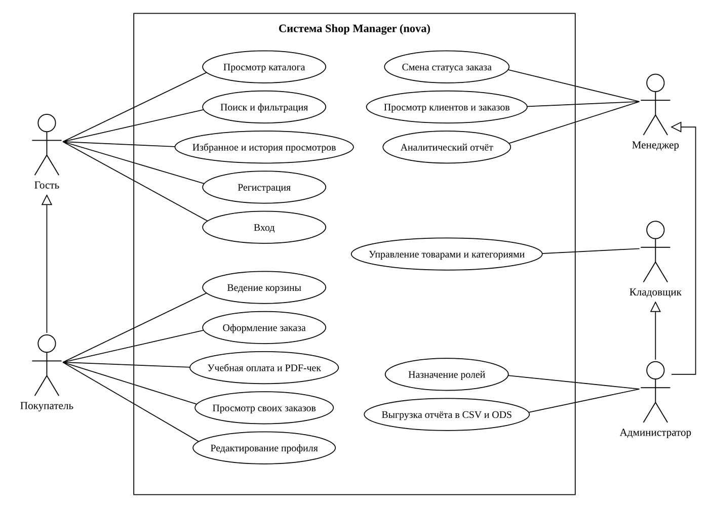

**Классы предметной области** — атрибуты с типами, кратности связей, композиции.

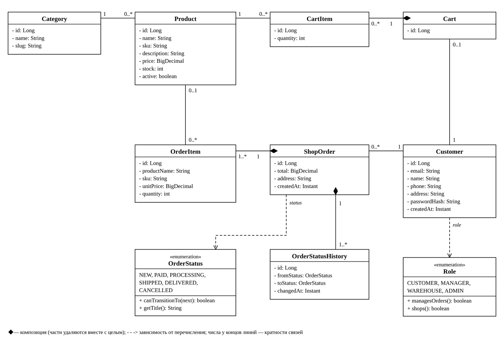

**Деятельность «Оформление и оплата заказа»**

<p align="center">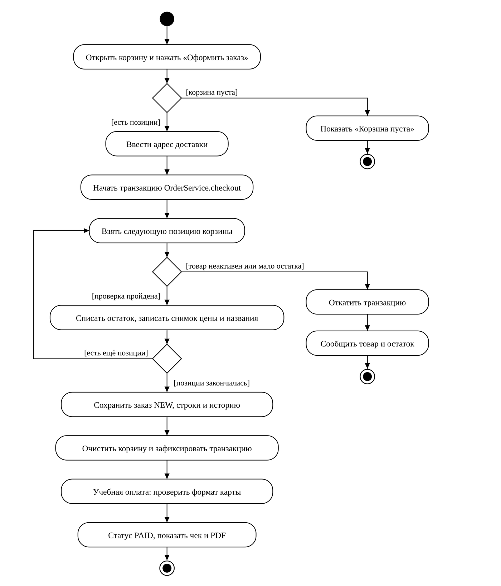</p>

**Последовательность оформления заказа**

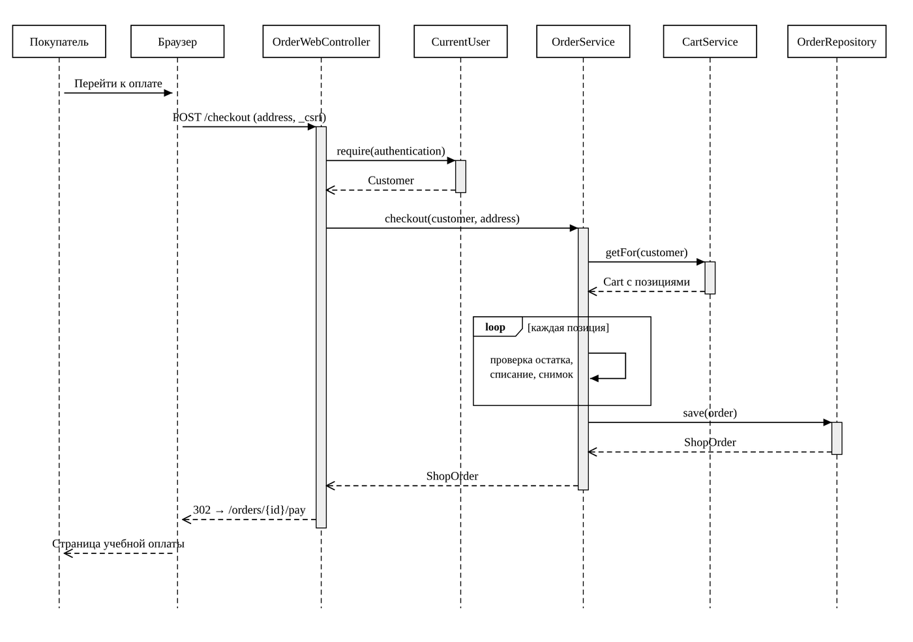

**Логическая схема базы данных** — 8 таблиц, внешние ключи, ограничения `CHECK` и `UNIQUE`.

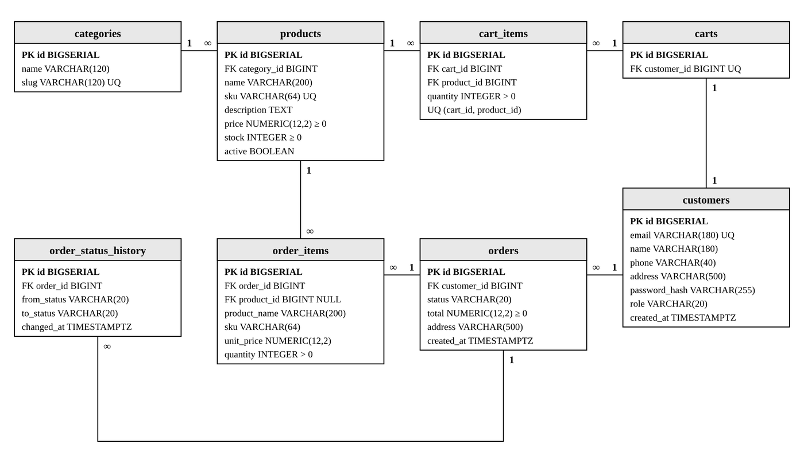

</details>

## 🔌 REST API

<details>
<summary><b>Маршруты и права доступа</b></summary>
<br>

| Метод | Путь | Доступ |
|---|---|---|
| GET | `/api/products`, `/api/products/{id}`, `/api/categories` | все |
| POST | `/api/auth/register` | все |
| GET / POST / PATCH / DELETE | `/api/cart`, `/api/cart/items` | покупатель |
| POST | `/api/orders` | покупатель |
| GET | `/api/orders`, `/api/orders/{id}` | свои заказы или сотрудник |
| POST | `/api/orders/{id}/status` | менеджер, администратор |
| GET / POST / PUT / DELETE | `/api/admin/products`, `/api/admin/categories` | кладовщик, администратор |
| GET | `/api/customers` | менеджер, администратор |
| GET | `/api/admin/report` | менеджер, администратор |

Ошибки различимы: `400` — пустое поле, `401` — нет входа, `403` — чужая роль, `404` — неизвестный объект, `409` — занятый артикул, пустая корзина или запрещённый переход статуса.

Коллекция Postman: [`postman/shop-manager.postman_collection.json`](postman/shop-manager.postman_collection.json).

</details>

## ✅ Тестирование

```bash
./gradlew test
```

<details>
<summary><b>27 тестов — что именно проверяется</b></summary>
<br>

| Класс | Тестов | Что проверяет |
|---|---|---|
| `ShopScenarioTest` | 18 | вход и роли, каталог и поиск, сортировка, конфликт артикула, корзина → заказ → оплата → отчёт, запрещённый статус, валидация, CSV и ODS, профиль, PDF-чек |
| `OrderStatusTest` | 2 | разрешённые и запрещённые переходы статуса заказа |
| `PageRenderTest` | 7 | настоящий Tomcat: формы входа и регистрации отдаются целиком с CSRF-токеном, статика открыта без входа, витрина гостя |

База тестов — H2 в режиме PostgreSQL, отдельный сервер не нужен.

</details>

## 🔐 Безопасность

- пароли пользователей хранятся как хеш **BCrypt**
- роль проверяется на сервере: покупатель не откроет админку, сотрудник не положит товар в корзину
- формы сайта защищены CSRF-токеном, он создаётся до отрисовки страницы
- чужой заказ для покупателя выглядит как отсутствующий
- сортировка каталога и отчёта принимается только из известного списка полей
- номер карты на учебной оплате не сохраняется
- локальный пароль базы — учебная учётка из `docker-compose.yml`, не личный секрет

## 📓 Дневник разработки

Как проект прошёл путь от простого каталога до витрины nova — по этапам, с датами, решениями и найденными багами: **[DEVLOG.md](DEVLOG.md)**.

<table>
  <tr>
    <td align="center" width="20%">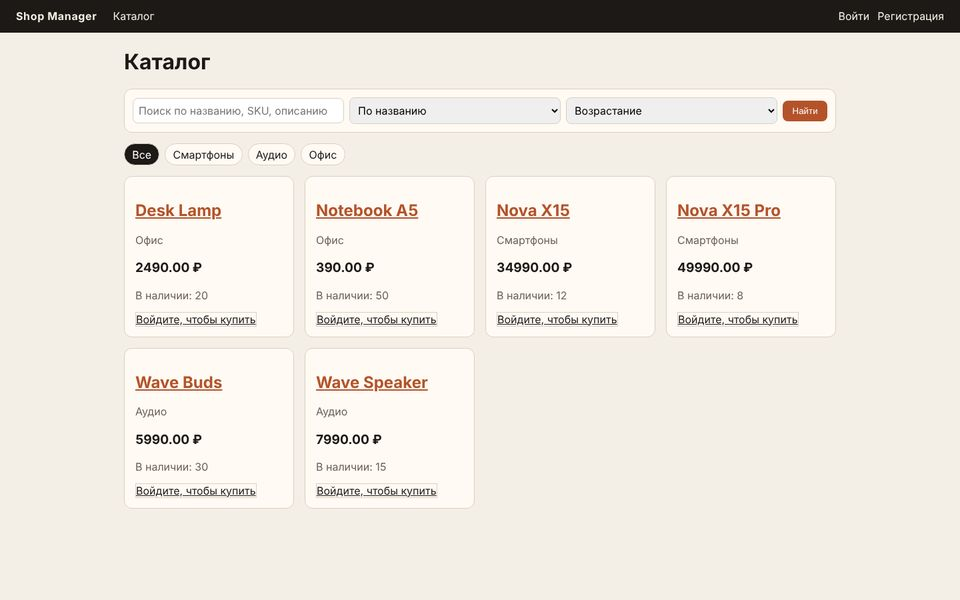<br><sub>07.10 · первый каталог</sub></td>
    <td align="center" width="20%">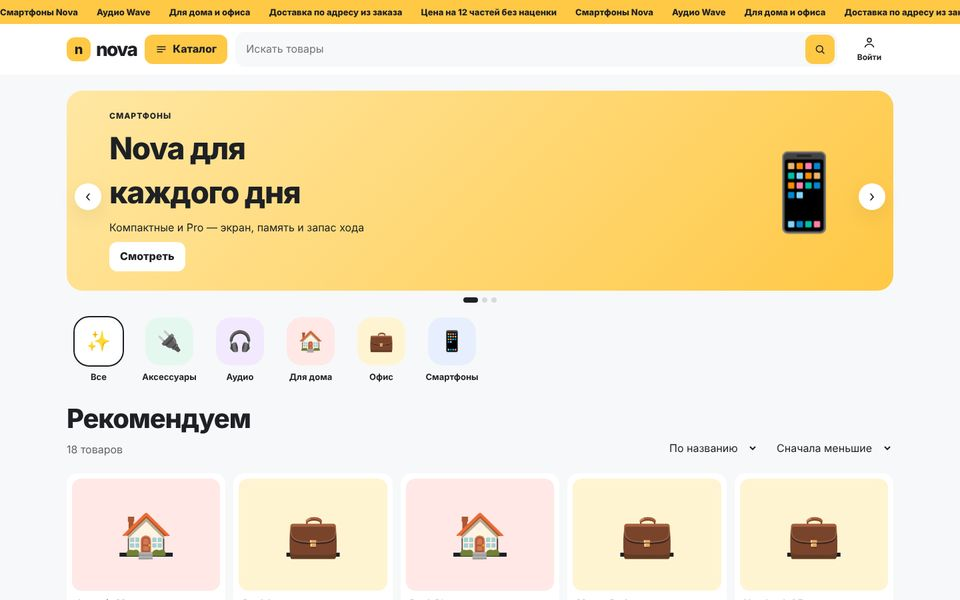<br><sub>29.10 · маркетплейс</sub></td>
    <td align="center" width="20%">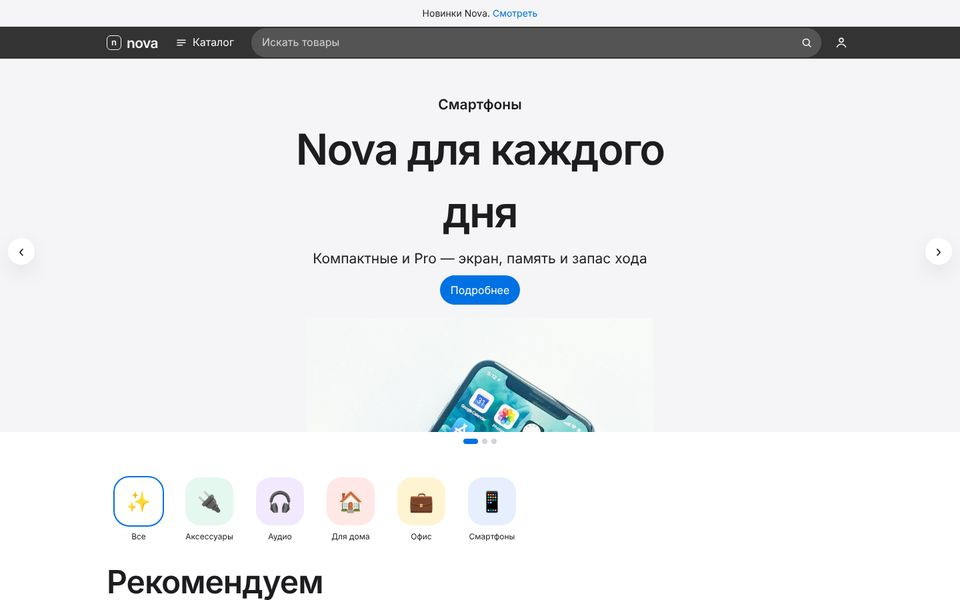<br><sub>29.10 · светлая</sub></td>
    <td align="center" width="20%">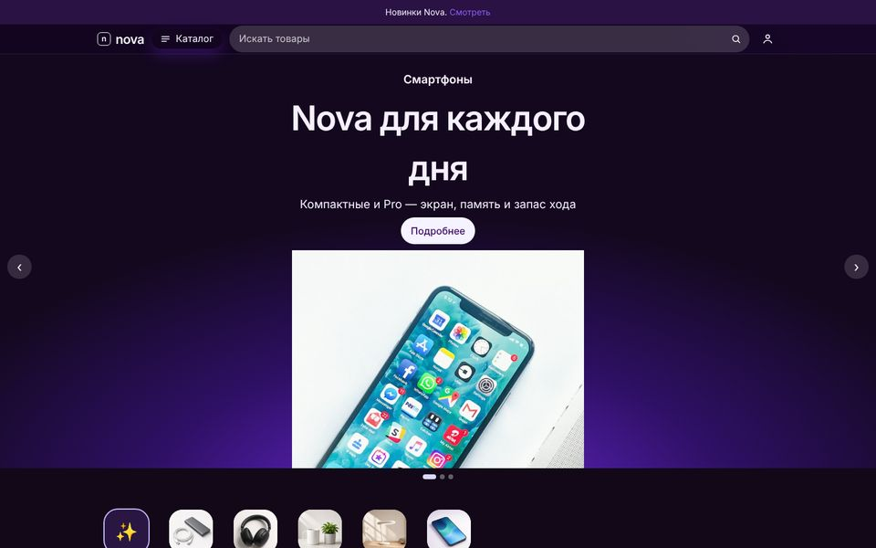<br><sub>05.11 · тёмная</sub></td>
    <td align="center" width="20%">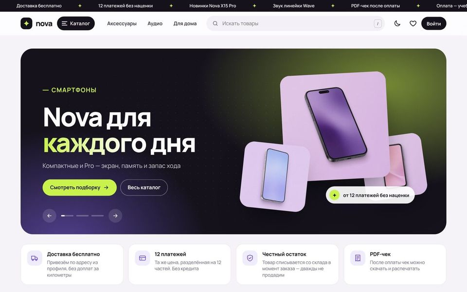<br><sub>18.11 · nova</sub></td>
  </tr>
</table>

## 🖼 Фото и лицензии

Снимки товаров и категорий лежат в репозитории, чтобы витрина открывалась без интернета. Шрифт Manrope — SIL Open Font License 1.1. Источники и оговорки — в [`src/main/resources/static/img/CREDITS.txt`](src/main/resources/static/img/CREDITS.txt). Учебные отчёты хранятся вне репозитория.

---

<p align="center">
  <b>Азар Абдулаев</b> · Российско-Таджикский (Славянский) университет · Душанбе · 2026<br>
  <a href="https://github.com/AzaEv">GitHub</a>
</p>
